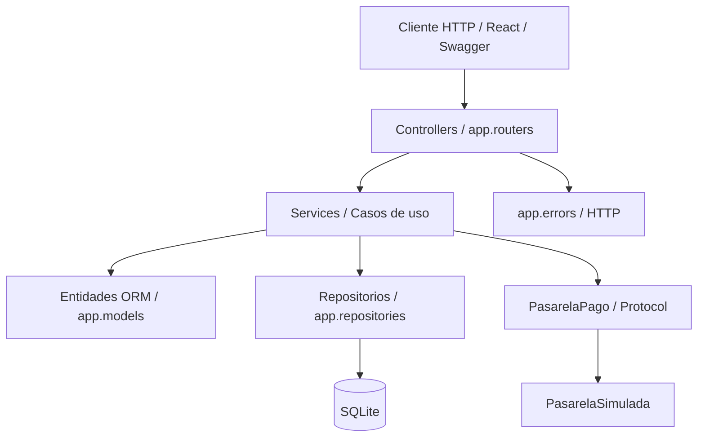
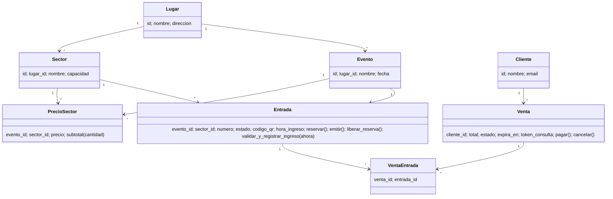
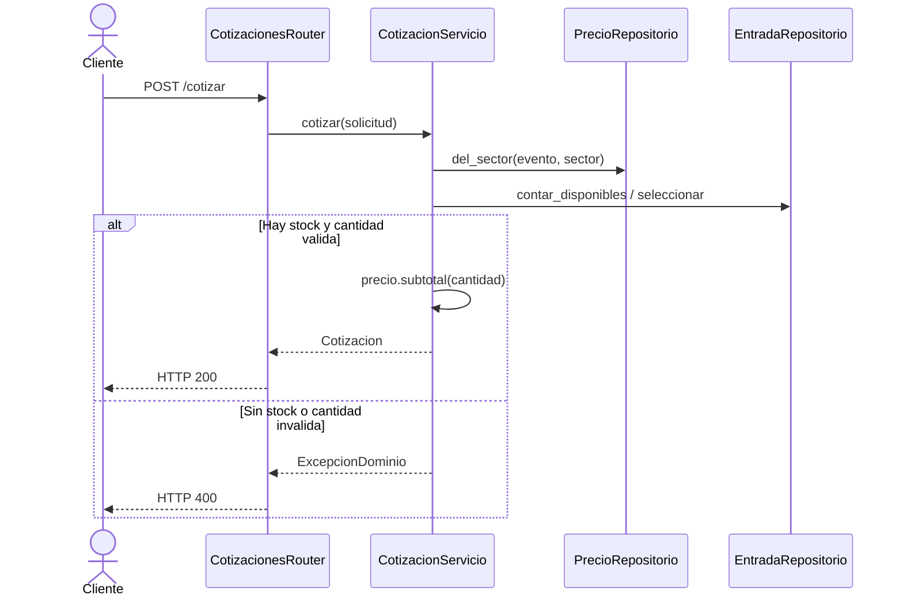
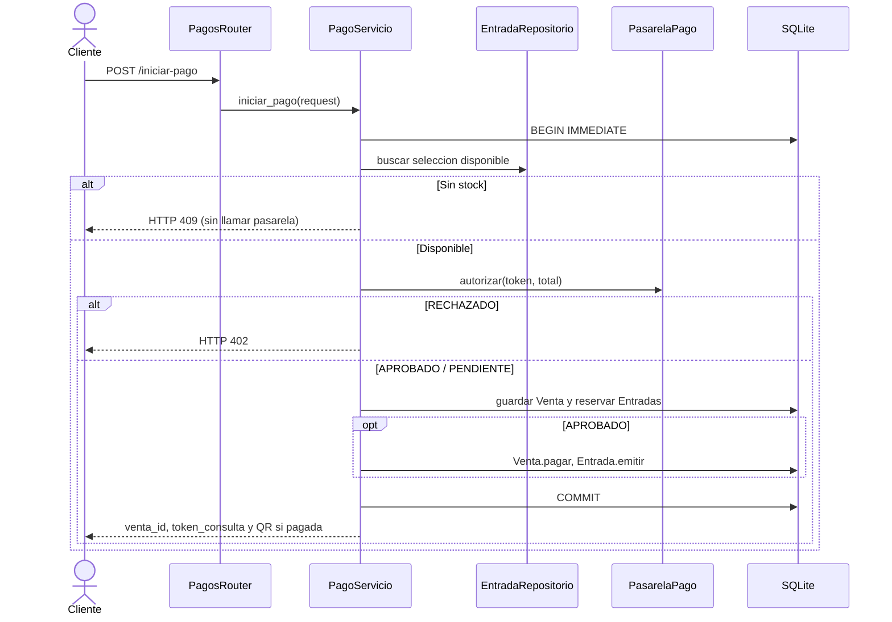
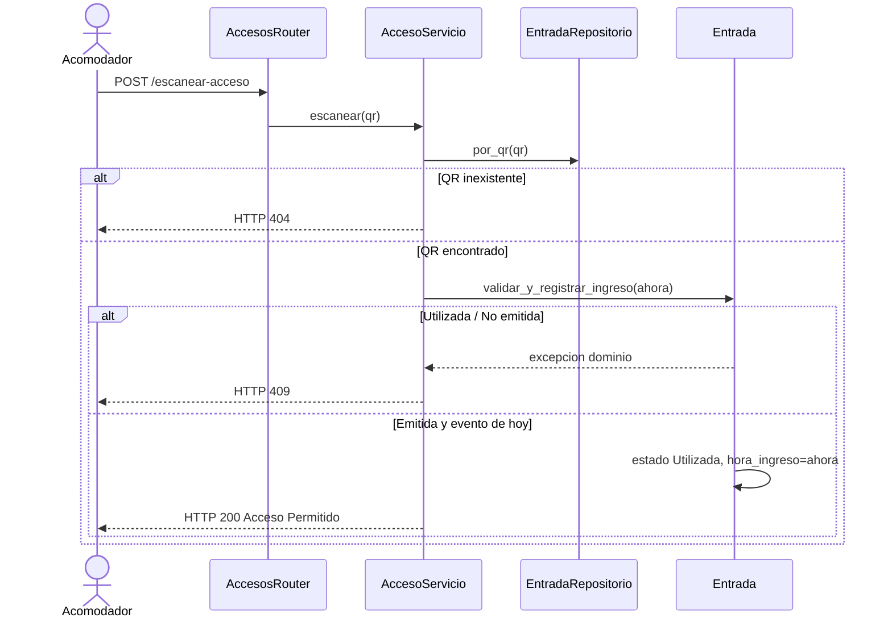

# SmartTicket 2 — Diagramas para el TP9

Podés pegar estos diagramas Mermaid en un visor compatible (por ejemplo, la vista previa de Markdown de VS Code con extensión Mermaid).

## Capas (relación de uso)

## Diagrama de clases (simplificado)

## Secuencia HU1

## Secuencia HU2

## Secuencia HU3

